

  

<h1 align="center">N2O Settings</h1>

  <strong>The settings tab for the N2O Paper theme.</strong> 
  134 controls on 12 pages, a short list of quick choices up front, looks you can save, and every control findable from Obsidian's own settings search.

  
  
  
  

  <a href="https://n2osync.com">Website</a> /
  <a href="https://github.com/n2osync/n2o-paper">The theme</a> /
  <a href="https://github.com/n2osync/n2o-paper-settings/issues/new">Report a bug</a> /
  <a href="https://github.com/n2osync/n2o-paper-settings/issues/new">Request a feature</a>

  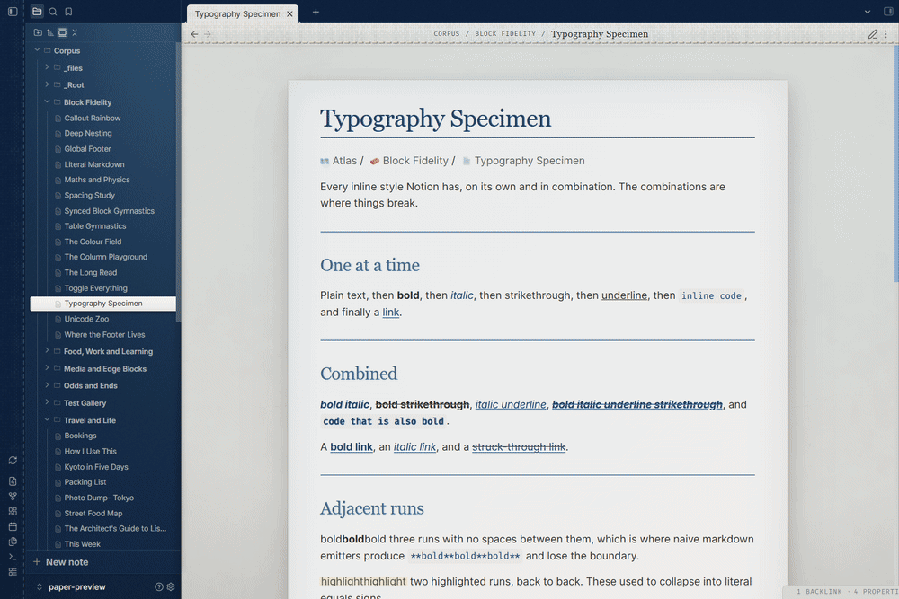

---

> **Not an Obsidian product.** N2O Settings is an independent plugin. It is
> not made by, endorsed by, or affiliated with Obsidian.

  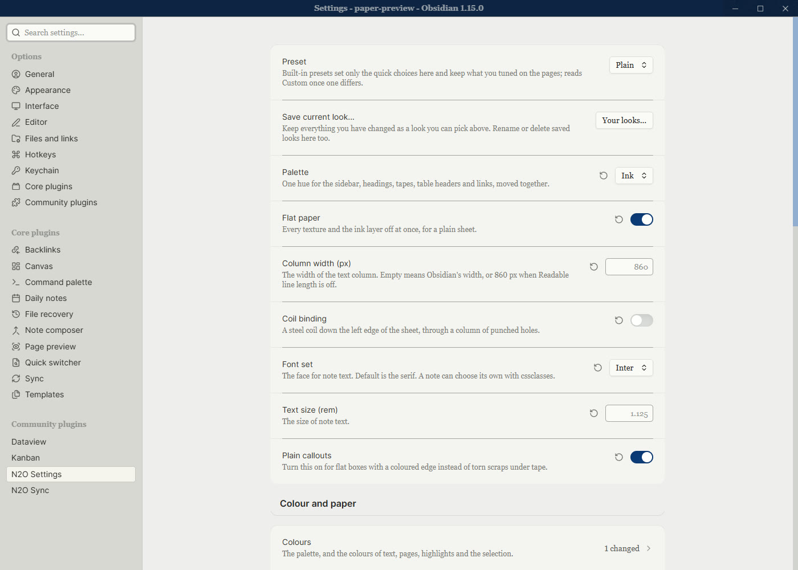

## What it does

An Obsidian theme is CSS and cannot draw a settings tab. N2O Paper lists its
controls, and this plugin turns them into one. The theme is complete without
it; install it when you want to change something.

- **Quick choices first.** The tab opens on the eight things most people
  change: preset, palette, flat paper, column width, coil binding, font set,
  text size and callout style.
- **Looks.** Three built in (Reading, Writing, Plain), plus any you save.
- **12 pages** for everything else, grouped under four headings.
- **Search.** Obsidian's settings search finds every control.
- **Commands and a status-bar menu** for switching without opening settings.
- **A picture menu.** Right-click a picture to resize it or set its flags.
- **Export, import and reset**, with a reset button on every row.

Every value syncs with the vault. Nothing is kept per device.

The plugin only paints while N2O Paper is the active theme and Obsidian is in
light mode. Switch theme and it applies nothing; your values wait for you to
switch back.

## Looks and quick switching

  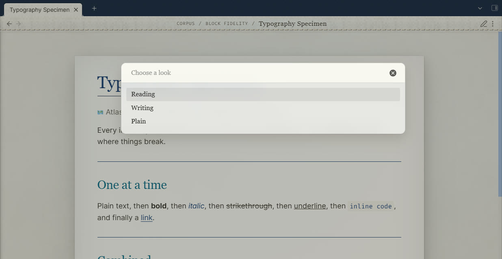

A look is a set of choices you put on in one go. Reading, Writing and Plain set
only the quick choices and keep anything you tuned on the pages. Change one of
those choices and the preset row reads Custom.

**Save current look...** keeps everything you have changed as a look of your
own. It then shows up in the same list, and you can rename or delete it there.

The command palette has these (no hotkeys are set for you):

- Choose a look...
- Apply look 1, 2 and 3
- Cycle palette
- Toggle flat paper
- Toggle coil binding
- Cycle column width
- Toggle callout style

Left-click the palette icon in the status bar for the same switches, with a
tick next to what is on.

  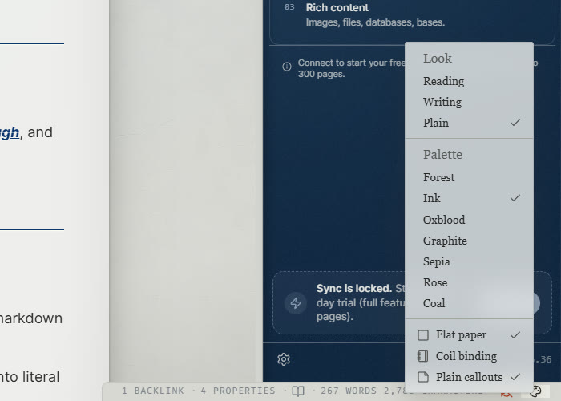

## Pages and search

Everything past the quick choices sits on 12 pages under four headings:

| Heading | Pages |
| --- | --- |
| Colour and paper | Colours, Paper and desk |
| Text | Text, Headings |
| Blocks | Callouts and quotes, Lists and tasks, Tables, Code, Pictures |
| Window and the rest | Window and sidebars, Synced from Notion, Accessibility |

Each page row says how many of its values you have changed.

Type in Obsidian's own settings search box and every control comes up, by its
name, its description, or the words for what it looks like. "torn" finds the
callout styles; "spine" finds the window frame.

  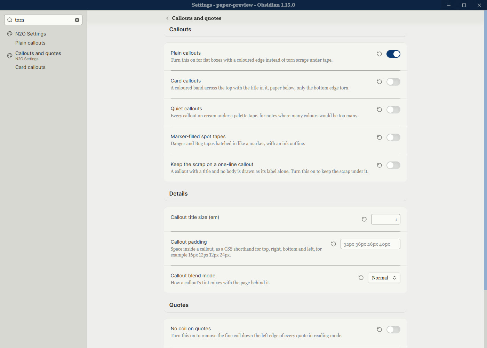

**Colours** holds the palette and every ink on the page, each with a swatch.

  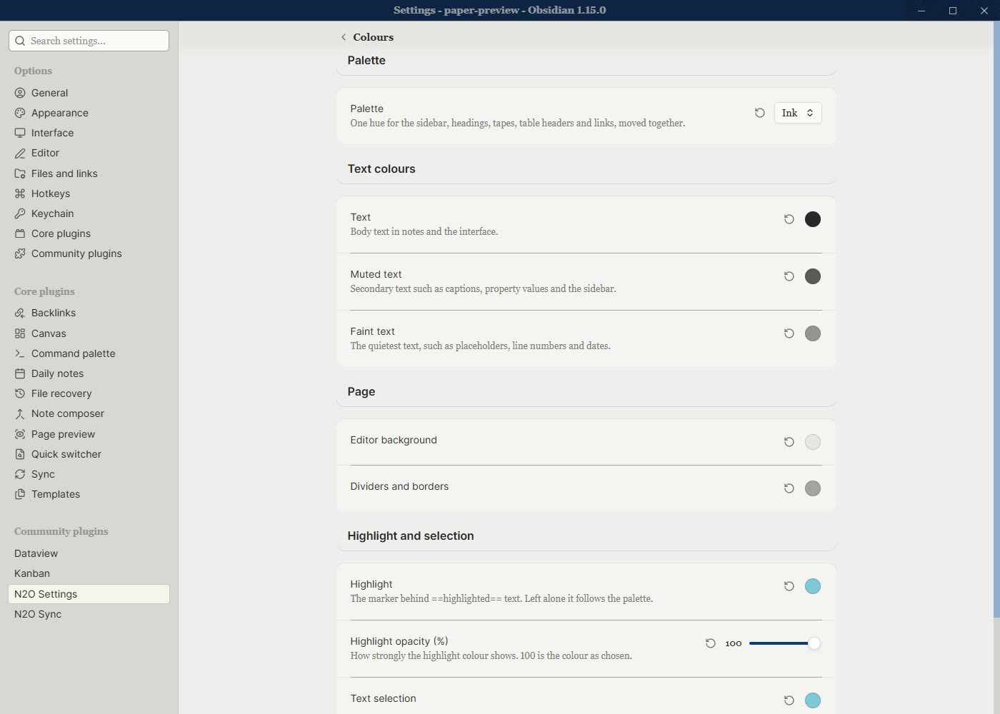

**Paper and desk** is the sheet, its texture and light, and the desk around it.

  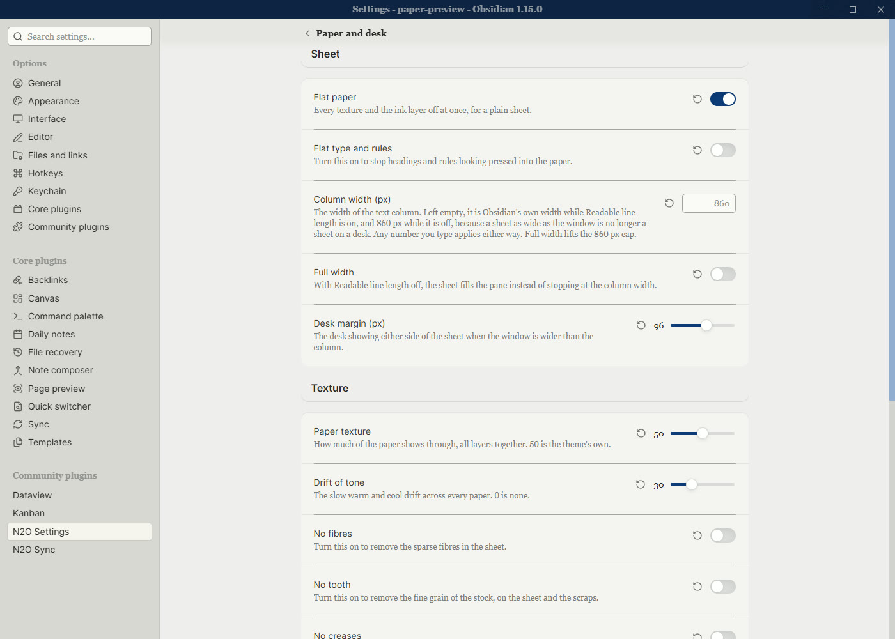

**Text** sets the fonts, the text size, emphasis and links.

  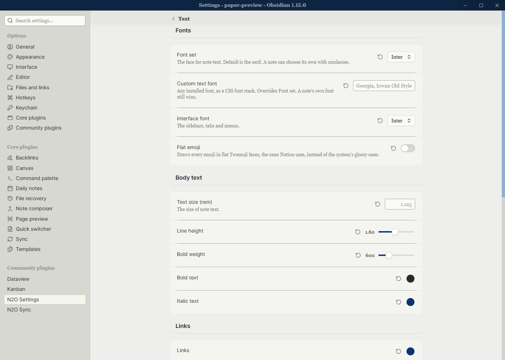

**Callouts and quotes** picks between torn scraps, flat boxes, cards and quiet
callouts.

  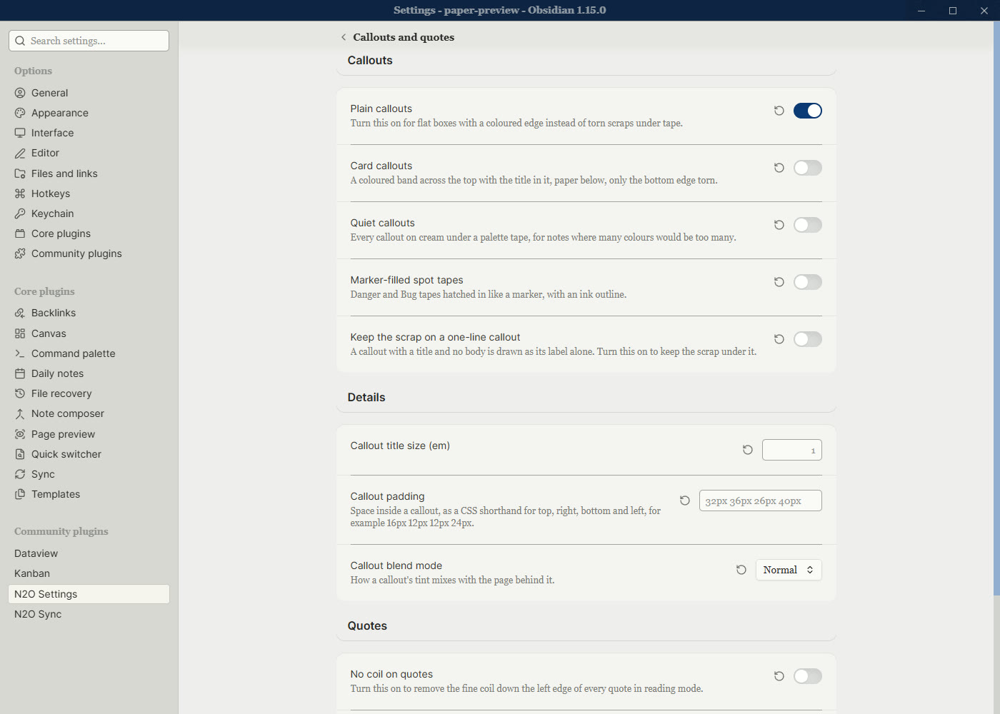

**Code** sets the code theme, the code font and its size.

  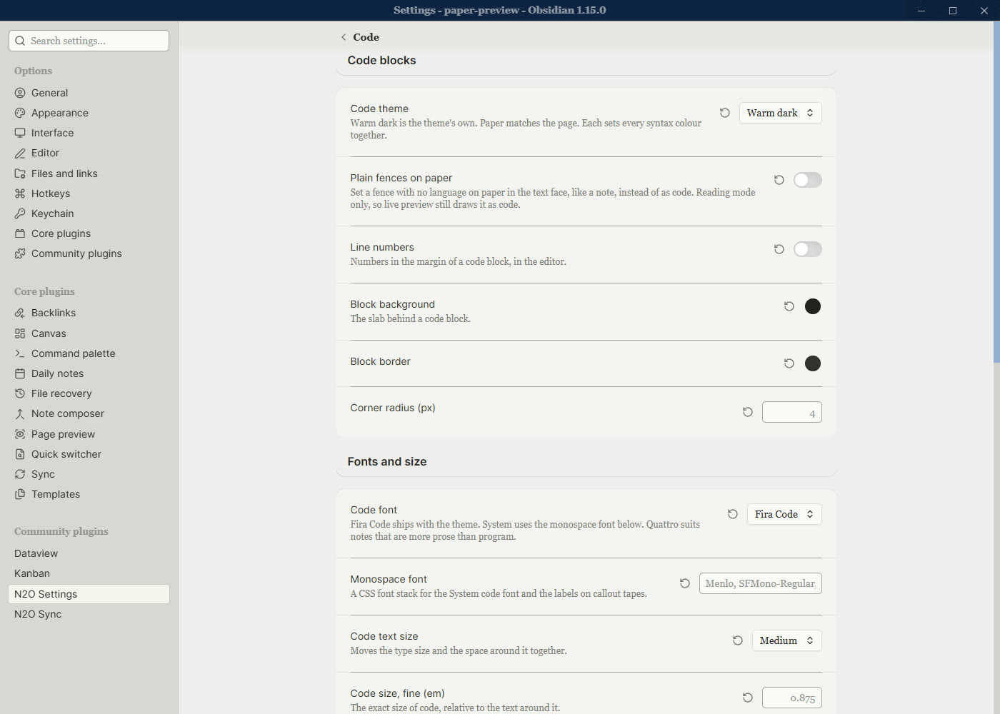

**Window and sidebars** covers the frame, the sidebars, tabs and scrollbars.

  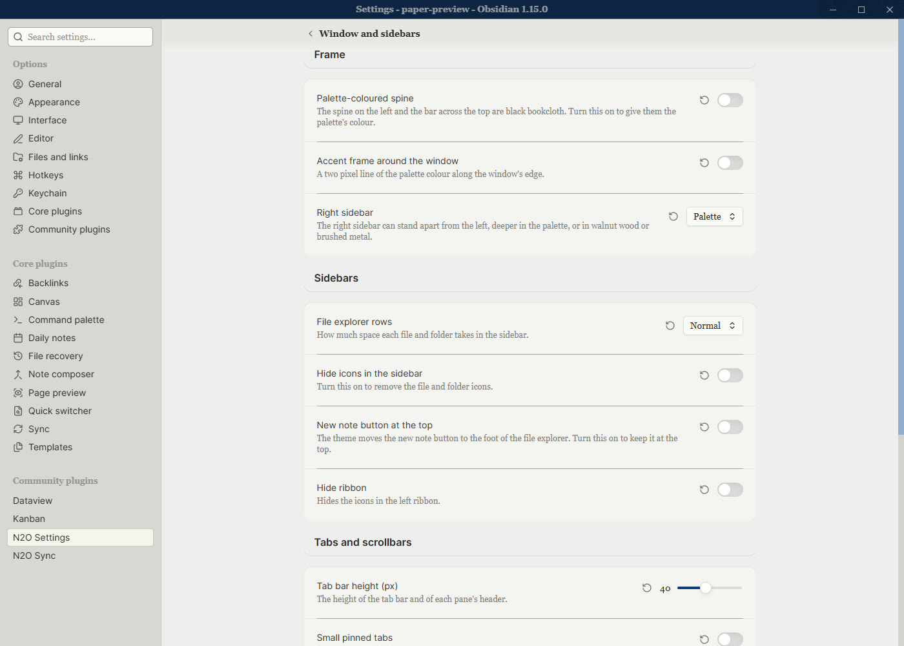

## Pictures menu

Right-click a picture in reading view or live preview. Along with copy, open,
rename and delete, the menu has:

- **Resize** by a percent of its current width (50%, 75%, 150%), or to a pixel
  width with Resize to...
- **The theme's picture flags:** no print mount, aged print, round, float left
  and float right.

  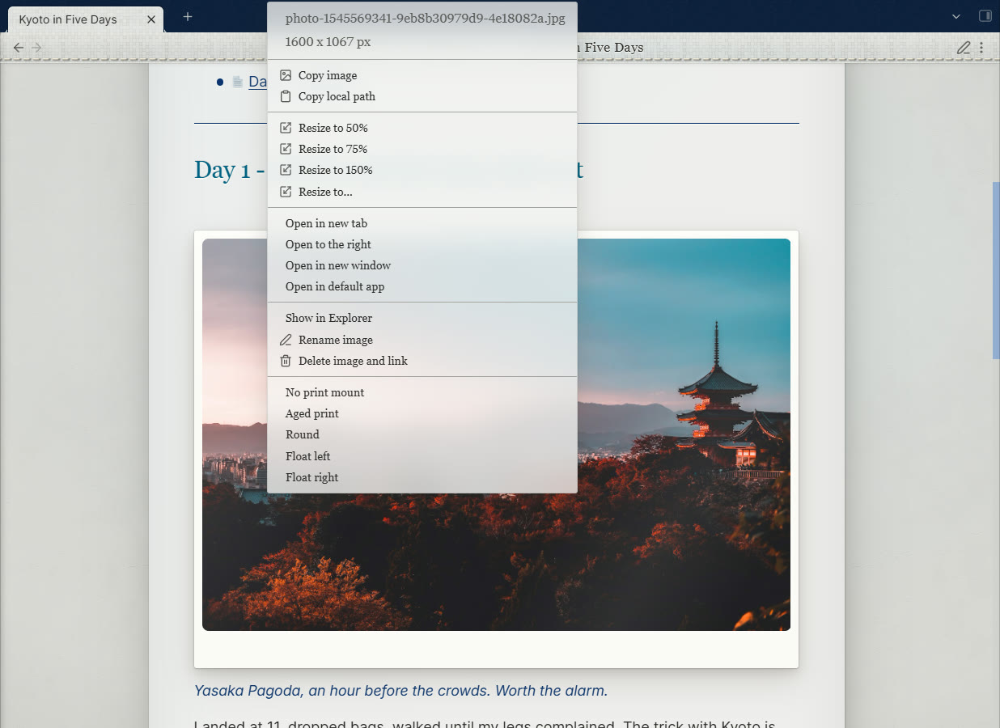

## A different font for one note

Run **Set the font for this note** from the command palette and pick one. Five
faces ship with the theme: Inter, IBM Plex, Fira Code, iA Writer Quattro, and
whatever you have set vault-wide.

It writes Obsidian's own `cssclasses` property, which means the choice lives in
the note rather than in this plugin. It travels with the note through renames,
moves, backups and git, it survives an N2O Sync without ever reaching Notion,
and it keeps working if you uninstall this plugin. Any `cssclasses` you already
had on the note are left alone.

## Export, import and reset

  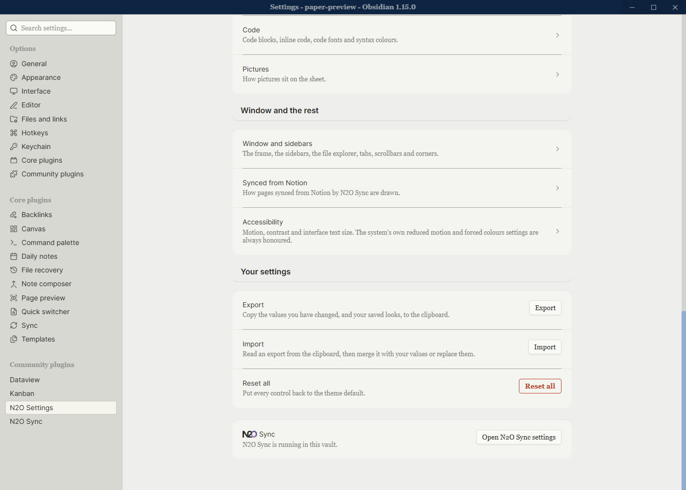

- **Export** copies only the values you have changed, plus your saved looks, to
  the clipboard.
- **Import** reads an export from the clipboard and asks whether to merge it
  with your values or replace them.
- **Reset all** asks first, then puts every control back to the theme default.
  Your saved looks stay.
- Every row also has its own reset button, which lights up once you change it.

## Automatic theme install

N2O Settings goes online only for the two things below, and sends nothing about you or your notes.

- **N2O Paper, on first load.** The first time this plugin loads in a vault that does not have
  the N2O Paper theme, it downloads the latest N2O Paper release from GitHub
  (github.com/n2osync/n2o-paper), checks the files, installs the theme and makes it the
  vault's active theme. It does this once per vault. If it cannot reach GitHub, it does not
  try again; the button in the settings tab does the same by hand. You can switch back to any
  theme in Settings, Appearance.
- **N2O Sync, only when you click Install.** The settings tab shows a card for N2O Sync, our
  plugin for syncing Notion and Obsidian. Clicking Install downloads N2O Sync's latest release
  from GitHub (github.com/n2osync/n2o), installs and turns it on, turns off N2O Lite if you
  have it, and writes a small install-source.json file into N2O Sync's folder noting that it
  was installed from here. Nothing is downloaded unless you click.

## Install

Settings > Community plugins > Browse, then search for N2O Settings.

To install it by hand, download `main.js`, `manifest.json` and `styles.css` from
the latest release into `<vault>/.obsidian/plugins/n-two-o-paper-settings/`, then
turn it on in Community plugins. It needs Obsidian 1.13 or newer.

## Licence

MIT. See LICENSE.md.
